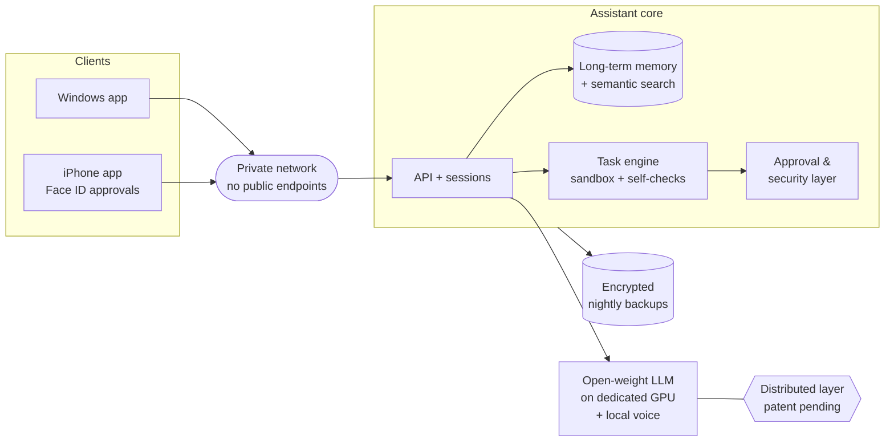

# IVEXA — case study

**A private, self-hosted AI assistant that I designed and built end to end (Oct 2025 – Oct 2026).**

This page explains the scope of the project and what was built. The source code is private,
and the distributed core technology is the subject of pending US patent applications,
so its internals are intentionally not described here.

## In one paragraph

IVEXA is a personal AI assistant that ran entirely on servers I controlled — no third-party AI cloud
saw the conversations or the data. It has long-term memory, carries out multi-step tasks on its own
with built-in self-checks, asks for biometric approval before anything sensitive, and was used every
day through native desktop and mobile apps, including by voice. Its core is built on a proprietary
distributed architecture that, in a live test, delivered a **1.85× speed-up with identical results**.

It ran 24/7 in my daily use from October 2025 to October 2026; it is currently archived and can be
redeployed on request.

## Scale at a glance

| Area | What was built |
|---|---|
| Clients | Windows desktop app and iPhone app (text + voice chat), connected over a private network only |
| Infrastructure | Deployed on a dedicated GPU server with an open-weight LLM, a main application server, encrypted storage, nightly encrypted backups with rotation, private networking, no public endpoints |
| Core | Assistant core with its own test suite, written over about a year before the first deployment |
| Memory | Long-term memory of every conversation, semantic search over the full history |
| Agent | Task engine: plans, executes in an isolated sandbox, tests the result, compares before/after |
| Safety | Approval layer — critical actions require Face ID on the phone; one approval can cover a whole pre-defined task chain |
| Security | Encrypted secrets vault, network guard for internet access, protection against hidden instructions in web pages and emails (prompt injection) |
| Operations | Self-healing watchdog, autonomous deployment of approved changes, tested migration to a new server |
| Voice | Fully local speech-to-text and text-to-speech (no cloud voice services) |
| Self-improvement | The system proposes upgrades to itself, tests them on a copy against a fixed exam suite, and only measured gains are accepted |
| R&D | Proprietary distributed (P2P) layer — US patent applications filed, details confidential |

## High-level architecture

## What this shows about how I work

- **Architecture ownership.** I defined the system, split it into components and stages, and made
  every design decision (recorded in a decision log).
- **Delivery to real use.** It was not a demo: it ran 24/7 in my daily use for a year (Oct 2025 – Oct 2026).
- **Quality by default.** Every change goes through tests in a sandbox; risky changes need explicit approval.
- **Security and privacy first.** Private network only, encryption at rest, secrets in a vault,
  prompt-injection protection.
- **Working with AI tools.** I use modern AI coding tools to move fast across stacks, and I review
  and test every result myself — the same approach shown in the other projects of this portfolio.

## Status

Archived since October 2026 (can be redeployed on request). US patent applications filed (patent pending). Technical details are available only under NDA.

Author: Andrei Zagainov · [LinkedIn](https://www.linkedin.com/in/andrei-zagainov-245087362) · zagainov.andrey.1989+jobs@gmail.com
