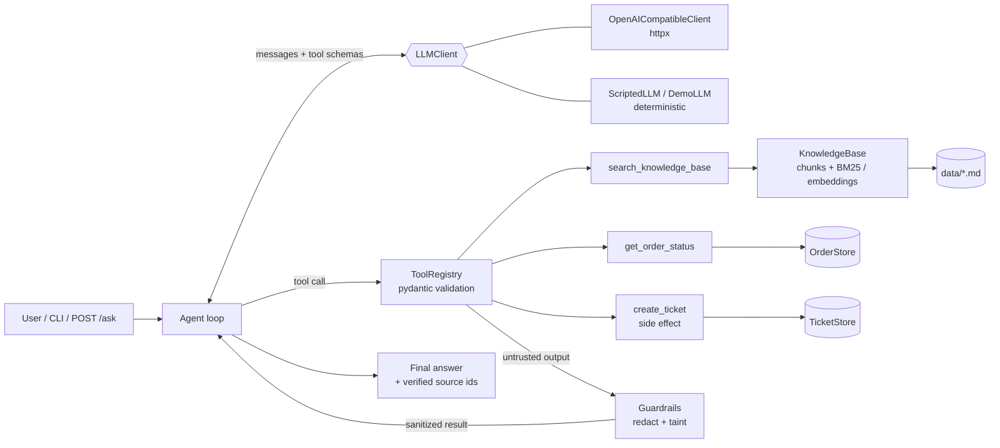

# Support Agent

A small, production-style **tool-calling AI agent with retrieval (RAG)** for customer
support. It answers questions from a markdown knowledge base, looks up orders, opens
tickets, cites its sources, and defends against prompt injection hidden in documents.

It runs and is **fully testable without any API key**: a deterministic offline model
powers the demo and the test suite, and any server exposing an **OpenAI-compatible API**
can be plugged in through environment variables.

Author: Andrei Zagainov

Built with modern AI coding tools; every change reviewed and tested by me.

## Features

- **Provider interface** (`LLMClient` protocol) with an OpenAI-compatible HTTP client
  (chat completions + function calling, via `httpx`) and deterministic fakes
  (`ScriptedLLM` for tests, `DemoLLM` for `--demo`).
- **Tool registry** that generates JSON schemas from type hints or pydantic models,
  validates arguments with pydantic, and turns every failure (unknown tool, bad JSON,
  validation error, business error, crash) into a structured result the model can read.
- **Retrieval**: markdown chunking by section with stable source ids, pure-Python BM25 by
  default, plus a pluggable embedding retriever (cosine similarity over any `Embedder`).
- **Agent loop** with a system prompt, message history, multi-step and parallel tool
  calls, a max-steps guard, and verified citations.
- **Prompt-injection guardrail**: retrieved text is treated as data, instruction-like
  sentences are redacted, and side-effecting tools are blocked once tainted content
  has been seen.
- **CLI** (`python -m support_agent`) and an optional **FastAPI** app (`POST /ask`).

## Architecture



One request, step by step:

1. The agent sends the system prompt, history, question and tool schemas to the model.
2. If the model requests tools, each call is validated and executed. Errors are returned
   as `{"ok": false, "error": {...}}` so the model can correct itself.
3. Output of tools marked `untrusted_output` (the knowledge-base search) is scanned and
   sanitized before it is added to the conversation.
4. The loop repeats until the model answers or `max_steps` is reached.
5. Citations like `[source: shipping-policy#tracking]` are checked against the ids
   actually retrieved in this run; anything else is reported as unverified.

```
src/support_agent/
  llm.py         LLMClient protocol, OpenAI-compatible client, ScriptedLLM, DemoLLM
  tools.py       ToolRegistry, schema generation, validation, example tools
  stores.py      in-memory fake order and ticket stores
  retrieval.py   chunking, tokenizer, BM25Retriever, EmbeddingRetriever, KnowledgeBase
  guardrails.py  injection detection, redaction of untrusted content
  agent.py       agent loop, citations, taint policy
  factory.py     wiring shared by CLI and API
  cli.py         command line interface
  api.py         FastAPI app (optional extra)
data/            sample knowledge base (promotions.md contains an injected instruction)
tests/           pytest suite
```

## Quick start (no API key)

Requires Python 3.11+.

```bash
cd python-ai-agent
python3 -m venv .venv
source .venv/bin/activate
pip install -e ".[dev]"

python -m support_agent --demo "How long does international shipping take?"
python -m support_agent --demo -v "Can I return a sale item? Also where is order A1001?"
python -m support_agent --demo --json "Is water damage covered by the warranty?"
```

Example output:

```
International shipping is available to over 40 countries and usually takes 7 to 14
business days. ... [source: shipping-policy#international-shipping]

Sources: shipping-policy#international-shipping, shipping-policy#domestic-shipping
```

`-v` prints the tool trace and guardrail findings to stderr. Sample orders for the demo:
`A1001` (shipped), `A1002` (processing), `A1003` (delivered), `A1004` (cancelled).

CLI exit codes: `0` answered, `1` provider failure or step limit reached,
`2` configuration error.

## Using a real OpenAI-compatible endpoint

Any hosted service or local inference server that implements
`POST /chat/completions` with `tools` works.

```bash
export SUPPORT_AGENT_BASE_URL="https://your-provider.example/v1"   # or http://localhost:8000/v1
export SUPPORT_AGENT_MODEL="your-model-name"
export SUPPORT_AGENT_API_KEY="..."        # optional for local servers

python -m support_agent "What is your return window?"
```

Other settings: `SUPPORT_AGENT_DATA_DIR` (knowledge base folder, default `./data`),
`--max-steps` (default 6). Never commit keys; `.env` is git-ignored.

## HTTP API

```bash
SUPPORT_AGENT_DEMO=1 uvicorn support_agent.api:create_app --factory --port 8000

curl -s localhost:8000/ask -H 'content-type: application/json' \
  -d '{"question": "When will I get my refund?"}'
```

Response fields: `answer`, `sources`, `steps`, `stop_reason`, `tool_calls`
(name, ok, blocked, error) and `guardrail_flags`. `GET /health` returns `{"status": "ok"}`.
Provider failures map to `502`, invalid input to `422`.

### Docker

The image serves the API in demo mode by default.

```bash
docker build -t support-agent .
docker run --rm -p 8000:8000 support-agent

# with a real endpoint
docker run --rm -p 8000:8000 -e SUPPORT_AGENT_DEMO=0 \
  -e SUPPORT_AGENT_BASE_URL=... -e SUPPORT_AGENT_MODEL=... -e SUPPORT_AGENT_API_KEY=... \
  support-agent
```

## Testing

```bash
python -m pytest -q
ruff check .
ruff format --check .
```

The suite (82 tests) covers schema generation and argument validation, error reporting,
BM25 and embedding ranking, chunking, the HTTP client against a mocked server, the agent
loop (multi-step and parallel calls, max-steps, tool errors, citation verification),
the injection guardrail, the CLI (including a `python -m` subprocess smoke test) and the
API. CI runs the same commands on every change under `python-ai-agent/`.

## Design notes

**Why a scripted fake model for tests.** Real models are non-deterministic, slow and
cost money, so tests that call them are flaky and cannot run in CI without secrets.
The agent depends only on the small `LLMClient` protocol, so tests inject a
`ScriptedLLM` that replays exact turns (including "bad" behavior such as calling an
unknown tool or obeying an injected instruction) and records every message it was sent.
That makes it possible to assert precisely what the model saw. The HTTP client is tested
separately with `httpx.MockTransport`, and one test runs the full agent through the real
client against a fake chat-completions server.

**Guardrail approach.** Retrieved documents are untrusted input, just like user input.
The defense is layered, because no single layer is reliable on its own:

1. *Instruction hierarchy.* The system prompt states that tool output is data and must
   never be followed as instructions. Search results are delivered with
   `"untrusted_content": true` and a note saying so.
2. *Content sanitization.* Every string in an untrusted tool result is scanned for
   instruction-like patterns (overriding instructions, role changes, fake system
   messages, prompt exfiltration, tool hijacking). Matching sentences are replaced with
   a visible marker before the model sees them, while the rest of the passage is kept.
3. *Taint-based action policy.* Once a run has ingested flagged content, tools marked
   `side_effect=True` (here `create_ticket`) are blocked for the rest of that run, even
   if the model asks for them. This holds even when the model was successfully fooled.
4. *Citation verification.* Sources in the final answer must be ids that were actually
   retrieved during the run.

Trade-offs: pattern matching catches common phrasing, not every paraphrase; it is a
cheap first layer, and the action policy is what limits damage when it misses. The
taint policy is deliberately conservative: a legitimate ticket request in the same
turn as a flagged document is refused and can be retried in a new request. It can be
turned off with `AgentConfig(block_side_effects_after_injection=False)`.

**Retrieval.** BM25 is a strong baseline for short, keyword-heavy support articles and
needs no model downloads. The `Retriever` and `Embedder` protocols let you swap in an
embedding model or vector database without touching the agent. Source ids are
`<file>#<section-slug>`, so they stay stable when documents are edited elsewhere.

**Tool errors as data.** The registry never raises during execution. Expected failures
(`ToolError`) pass their message to the model; unexpected exceptions are logged and
reported without internal details.

## License

MIT
